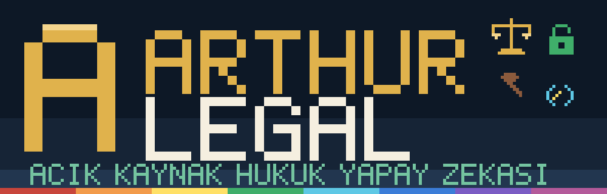

# ArthurLegal Setup v3.4.7

**Tek dosyalık kurulum, Windows ve macOS.** Kullanıcı indirir (Windows'ta `ArthurLegal-Kurulum.exe`, Mac'te
`ArthurLegal-Kurulum.pkg`), çift tıklar, modül ekranında işine yarayan paketleri (Hukuk Bürosu, Kurumsal Asistan,
Courthouse, Akademisyen) ve araçları (ArthurLegal Tapu, ArthurMask, ArthurLegal Hafıza) seçer; seçtikleri, araştırma bağlantısıyla
birlikte seçtiği yapay zekâ uygulamasına (Claude Desktop, ChatGPT masaüstü ya da ikisi; 3.4.0) kendiliğinden bağlanır.
Yönetici yetkisi gerekmez. Sonraki sürümler arka planda, imzası
doğrulanarak sessizce kurulur. İki kurulum aynı paketleri, aynı modülleri ve aynı güncelleme kanalını kullanır.

> Paketlerin kendisi (SYSTEM_PROMPT + knowledge) bu deponun kökündedir ve Claude.ai'de elle de
> kurulabilir: her paketin `KURULUM.md` dosyası. Bu klasör, o kurulumu tek tıka indiren ve
> güncel tutan Windows ve macOS kurulumudur.

## Ne kurulur

Lisans sayfasından sonraki **Modülleri seçin** ekranında her modül bir onay kutusu ve altında kısa açıklamadır.
İlk kurulumda hiçbir kutu işaretli gelmez, en az bir paket gerekir; kurulum yeniden açılınca son seçim işaretli
gelir. Seçim kurulum klasöründeki `moduller.json`'a yazılır ve güncellemelerde korunur. 2.5.0'dan önceki
kurulumlarda bu dosya yoktur; onlar eski modülleriyle (Hukuk Bürosu, Kurumsal, Tapu, ArthurMask) sürer.

| Modül | Kod | Masaüstü simgesi | Ne yapar |
|---|---|---|---|
| **Hukuk Bürosu** | `hukuk-burosu` | ArthurLegal | Law Firm paketi: avukatlar ve hukuk büroları |
| **Kurumsal Asistan** | `kurumsal` | ArthurLegal | Corporate paketi: şirket hukuk birimleri |
| **Courthouse** | `adliye` | ArthurLegal - Courthouse | Hâkim ve kalem için tarafsız taslak paketi |
| **Akademisyen** | `akademisyen` | ArthurLegal - Akademisyen | Academician paketi: hukuk akademisyenleri |
| **ArthurLegal Tapu** | `tapu` | ArthurLegal - Tapu | Yerel `arthur-tapu` sunucusu (aşağıda) |
| **ArthurMask** | `mask` | ArthurMask (kendi kurulumundan) | Kurulum sırasında indirilir; kuruluysa kutu işaretli ve kilitli görünür |
| **ArthurLegal Hafıza** | `hafiza` | (yok; Başlat menüsünde Hafıza Klasörü) | Sohbetler arası hafıza: `arthurlegal-yerel`'in `hafiza_` araçları (aşağıda) |

macOS'ta simgeler Uygulamalar klasöründe (`~/Applications`, Launchpad'de) küçük uygulamalardır; adlarında tire ve
sürüm numarası yoktur: **ArthurLegal**, **ArthurLegal Courthouse**,
**ArthurLegal Akademisyen**, **ArthurLegal Tapu**. Masaüstündeki takma adlar Windows kısayolları gibi sürümü taşır
(ör. "ArthurLegal 3.4.1"). ArthurMask'in masaüstü simgesi de bu düzendedir: adı bitişik yazılır ve
ArthurMask'in kendi sürümünü taşır ("ArthurMask 1.4.0"). Mac'te takma adı kurulum koyar; Windows'ta ArthurMask'in
kendi kısayolunun adı düzeltilir (eski "Arthur Mask" adı ve sürümsüz ad gider), içeriğine dokunulmaz.

Bileşenler:

| Bileşen | Nerede çalışır | Ne yapar |
|---|---|---|
| **arthurlegal-yerel** | Claude Desktop ve/veya ChatGPT · kurulumun Python 3.12'si | Seçilen paketlerin sistem talimatını ve bilgi dosyalarını araç olarak sunar; `arthurlegal-mcp.fly.dev` araştırma araçlarını (TR + 11 yargı çevresi, 100+ araç; `tkgm_` dışındakiler) köprüler. Ayrıca connector eklemeye gerek kalmaz. Kurulumda yeni arayüz seçildiyse ArthurLegal Masası'nı da sunar (`al_masasi`, `al_modul_ac`; klasik arayüzde masa ve kartlar kapalıdır, sonuçlar metin gelir). Tek paket seçildiyse o varsayılandır; birden çoksa talimat, hangi işte hangi profilin çağrılacağını söyler |
| **arthur-tapu** | Claude Desktop + masaüstü kısayolu | Yalnız Tapu seçildiyse. tkgm-mcp 0.6.1: TKGM Parsel Sorgu'dan canlı parsel (il/ilçe/mahalle listeden, ada/parsel ayrı kutularda) (dakikada en çok 30 istek, sohbet başına onay kartı), parsel raporu, kroki, harç, tapu kaydı maskeleme, Word/Excel çıktı, yerel tarayıcı arayüzü |
| **arthur-mask** | Claude Desktop + kendi arayüzü | Müvekkil ya da dosya belgelerini bilgisayarda maskeleyen gizlilik kapısı. Seçildiyse kurulum sırasında indirilir (≈1 GB); seçilmediyse güncelleyici de indirmez |
| **hafiza_ araçları** | `arthurlegal-yerel` içinde | Yalnız ArthurLegal Hafıza seçildiyse (2.6.7, `istemci/hafiza.py`). Kasa `~/ArthurLegal-Hafiza` (ayar.json → `hafiza_dizini` ile var olan bir Beyin kasası da verilebilir); düzen [Beyin](https://github.com/avenoxai/avenoxbeyin)'inkidir: `🔮 850-Companion/` (Core, Kurallar, Last-Session, Threads, Journal), `knowledge/`, `Projeler/<dosya kodu>/`. Beş araç: `hafiza_baslangic`, `hafiza_ara`, `hafiza_getir` (salt okunur), `hafiza_yaz`, `hafiza_oturum_karti` (yazar; Claude Desktop izin sorar). Yazmadan önce kişisel veri kapısı: T.C. kimlik numarası, IBAN, telefon, e-posta reddedilir. Devir kartları 3.000 karakteri aşınca eskileri `Arşiv/`'e taşınır, silinmez. Kaldırma kasayı silmez |
| **arthur-uyap** | Claude Desktop + UYAP Dashboard (yalnız Windows; ArthurMask'in Python'u) | 3.0.0'dan beri genel kurulumda: Windows'ta Hukuk Bürosu ya da Kurumsal ile ArthurMask seçildiyse kaydedilir ve masaüstüne ile Başlat menüsüne UYAP için tek simge ekler: "ArthurLegal - UYAP Dashboard" (`ortak.uyap_acik`). Köprü 2.0.0 gözlem kanalıyla çalışır: avukatın UYAP'ta açtığı listeleri okur, kalibrasyon istemez, UYAP'a ek istek göndermez; sınırlar ana README'nin UYAP Dashboard bölümünde. Masanın UYAP ekranı köprünün `durum-ozeti.json` ve `hiz.json` dosyalarını okur (`ortak.uyap_ozeti`; kişisel veri yok). macOS paketinde yoktur |

Claude Desktop kurulu değilse Windows'ta `winget` ile kullanıcı kapsamında kurulur; Mac'te başlangıç paneli
[claude.ai/download](https://claude.ai/download) adresini gösterir.

## Yapay zekâ uygulaması: Claude Desktop, ChatGPT ya da ikisi (3.4.0)

Lisanstan hemen sonraki **Yapay zekâ uygulamanızı seçin** ekranında iki kutu vardır: **Claude Desktop** ve **ChatGPT**
(ChatGPT'nin yeni masaüstü uygulaması; Windows'ta Microsoft Store paketi `OpenAI.Codex`, eski "ChatGPT Classic" yerel
sunucu çalıştırmaz). Bu bilgisayarda kurulu olan önden işaretli gelir, hiçbiri kurulu değilse Claude Desktop; en az biri
gerekir. Seçim `durum.json`'a (`asistan`: `claude`, `chatgpt`, `ikisi`) ve kurulumun önceki verisine yazılır. macOS
paketinde iki kutu Özelleştir ekranında listenin başındadır; zip kurulumu konsolda sorar. Sessiz kurulum:
`/ASISTAN=claude|chatgpt|ikisi` (verilmezse önceki seçim, o da yoksa Claude Desktop).

| Seçim | Kurulum ne yazar | Masaüstü simgesi |
|---|---|---|
| Claude Desktop | `claude_desktop_config.json`'a yerel sunucular (`istemci/claude_ayari.py`) | Claude Desktop'u masa mesajıyla açar (`claude://claude.ai/new?q=…`) |
| ChatGPT | `~/.codex/config.toml`'a yerel sunucular ve `~/.codex/skills`'e kural + 11 alan becerisi (`istemci/codex_ayari.py`) | ChatGPT'yi masa mesajıyla açar (`codex://new?prompt=…`); masa ChatGPT'nin yan panelinde |
| İkisi | İkisini de | Yalnız başlangıç panelini açar; panelde "Claude Desktop'ta aç" ve "ChatGPT'de aç" düğmeleri |

- `codex_ayari.py` TOML dosyasında yalnız ArthurLegal'in tablolarını (`[mcp_servers.arthurlegal-yerel]`, `arthur-tapu`,
  `arthur-uyap`, `arthur-mask`) yazar; öteki satırlar bayt bayt kalır, önce yedek alınır (son 5), kullanıcının
  ChatGPT'de kapattığı sunucu kapalı kalır, bozuk dosyaya dokunulmaz. Yerel sunucu ChatGPT'de `AL_EV=chatgpt` ile
  açılır (masa model sormaz; ChatGPT modelleri ölçülmedi). ArthurMask'in kendi kurulumu yalnız Claude Desktop'a
  yazdığı için ChatGPT'deki `arthur-mask` girdisini bu kurulum yazar.
- ChatGPT kurulu değilse Windows'ta Microsoft Store'dan (`winget install --id 9PLM9XGG6VKS --source msstore`) kurulmaya
  çalışılır; olmazsa simge resmî indirme sayfasını ([chatgpt.com/download](https://chatgpt.com/download/)) açar. Mac'te
  kurulum ChatGPT'yi kurmaz.
- Seçim değişirse işareti kaldırılan uygulamadan ArthurLegal sunucuları (ChatGPT'de becerileri de) silinir; yalnız seçim
  kurulumda açıkça yapıldıysa (seçim kaydı olmayan eski kurulumlarda güncelleyici elle yapılmış ayara dokunmaz).
- Güncelleyici her sürümde ikisini de tazeler (`kur --kaydet`); ArthurMask güncellemesi seçilen uygulama(lar) açıkken
  bekler. ChatGPT seçildiyse kurulum ChatGPT'yi de kapatır (yerel sunucu dosyaları tutmasın).

## Kurulum

1. **[ArthurLegal-Kurulum.exe](https://github.com/beerbottle90/ArthurLegal/releases/latest/download/ArthurLegal-Kurulum.exe)**
   dosyasını indirin (bağlantı her zaman en son sürümü verir) ve çift tıklayın. Edge ya da Windows uyarı
   verirse resimli anlatım [ana sayfanın indirme bölümünde](https://github.com/beerbottle90/ArthurLegal#indir);
   kısaca Edge'de **⋯ → Sakla**, sonra mavi **Sil** düğmesinin yanındaki ok **→ Yine de sakla**; mavi
   "Windows kişisel bilgisayarınızı korudu" penceresinde **Ek bilgi → Yine de çalıştır**. Kurulum İngilizce,
   Türkçe ve Azerbaycancadır: açılışta dil sorulur, Windows'un diline uyan dil seçili gelir. Kısayol adları ve
   başlangıç rehberi seçilen dilde yazılır. Lisanstan sonra modülleri seçin (yukarıda).
2. Claude Desktop'ta **yeni bir sohbet açıp hukuki sorunuzu doğrudan yazın.** Proje ya da yapıştırma
   gerekmez: `arthurlegal_talimat` aracının açıklaması ve sunucunun `instructions` alanı modele "hukukla
   ilgili her soruda önce beni çağır" der; profil verilmezse kurulumdaki varsayılan kullanılır.
3. Claude bir aracı ilk kez kullanırken izin sorarsa **Always allow**'u (Her zaman izin ver) seçin; Claude
   Desktop'un menüleri İngilizcedir. Araç izinleri Claude Desktop'ın kendi deposunda tutulur; kurulum bunları
   önceden işaretleyemez. Araştırma araçları salt okunur diye işaretlenir (2.4.4), böylece Claude kalıcı izin
   sunabilir.

**Yedek yollar.** (1) Kurulum seçilen her paket için `%USERPROFILE%\ArthurLegal\` altında bir proje klasörü
hazırlar (`Hukuk Bürosu`, `Kurumsal`, `Courthouse`, `Akademisyen`; içinde `CLAUDE.md`, `SYSTEM_PROMPT.md`,
`knowledge/`; güncelleyici her sürümde yeniler, kullanıcının kendi dosyalarına dokunmaz): Claude'da
**Projects → New project → Use a folder** ile seçilir. (2) Başlangıç panelindeki kısa talimat bir projenin
**Instructions** alanına yapıştırılır. (3) Sohbette **+** menüsünden `arthurlegal-yerel` altındaki paketin istemi
(`hukuk-burosu`, `kurumsal`, `adliye`, `akademisyen`) seçilir.

**Sessiz kurulum.** `ArthurLegal-Kurulum.exe /VERYSILENT /SUPPRESSMSGBOXES /MODULLER=adliye,tapu,mask /ARAYUZ=klasik`.
`/ARAYUZ=yeni|klasik` arayüzü seçer (yeni: ArthurLegal Masası; klasik: Claude Desktop'un kendi sohbeti); verilmezse
önceki kurulumun seçimi, o da yoksa yeni arayüz kullanılır. Liste
geçersizse (bilinmeyen ad, derlemede olmayan modül ya da hiç paket yok) kurulum hiçbir şey kurmadan durur.
`/MODULLER` verilmezse önceki kurulumun seçimi, o da yoksa 2.5.0 öncesinin modülleri kullanılır.

**Windows 11 Akıllı Uygulama Denetimi (Smart App Control) açıksa** imzasız kurulum motoru engellenir
(`Hata 4551`). O bilgisayarda [`ArthurLegal-Kurulum.zip`](https://github.com/beerbottle90/ArthurLegal/releases/latest/download/ArthurLegal-Kurulum.zip) dosyasını indirin;
ayıklamadan önce **Özellikler → Engellemeyi Kaldır** (denetim internetten gelen `.cmd` dosyasını engeller, Gezgin
bu işareti zipten çıkan dosyalara taşır), sonra klasöre çıkarın ve `KUR.cmd` dosyasına çift tıklayın: aynı
kurulumu imzalı Python ile yapar, modülleri konsolda numarayla sorar (ArthurMask bu yolla kurulamaz). Zip'in içinde Türkçe `BENIOKU.txt` ve İngilizce `README.txt` vardır. Denetim
açıkken ArthurMask kurulamaz; güncelleyici onu indirmeye çalışmaz (2.4.4). Denetim durumu:
`(Get-MpComputerStatus).SmartAppControlState`.

Kaldırma: **Ayarlar → Uygulamalar → ArthurLegal**, ya da zip yoluyla kurulduysa kurulum klasöründeki
`KALDIR.cmd`.

## macOS

**[ArthurLegal-Kurulum.pkg](https://github.com/beerbottle90/ArthurLegal/releases/latest/download/ArthurLegal-Kurulum.pkg)**
macOS 11 ve sonrası; Apple Silicon ve Intel için tek paket. Resimli anlatım
[ana sayfanın Mac bölümünde](https://github.com/beerbottle90/ArthurLegal#mac).

- **İlk açılış.** Paket henüz Apple noter onayı (notarization) taşımaz: macOS ilk açılışta durdurur, bir kez
  **Sistem Ayarları → Gizlilik ve Güvenlik → Yine de Aç** ile izin verilir.
- **Sihirbaz.** macOS Installer: karşılama, lisans, **Yükleme Türü** ekranında modüller (Windows sihirbazıyla aynı
  ad ve açıklamalar, `kurulum/ArthurLegal.iss`'ten), kurulum, bitiş. Kurulum yalnız kullanıcının ev klasörüne
  yapılır, yönetici şifresi istemez. Yeniden açılınca son seçim işaretli gelir.
- **Nereye.** `~/Library/Application Support/ArthurLegal` (Windows'taki `%LOCALAPPDATA%\Programs\ArthurLegal`'ın
  karşılığı; içinde `runtime/bin/python3`, `bin/al.py`, `surumler/`). Claude Desktop kaydı
  `~/Library/Application Support/Claude/claude_desktop_config.json`'a, proje klasörleri `~/ArthurLegal`'a yazılır.
  Paket iki Python taşır (Apple Silicon ve Intel); kurulumun son adımı bilgisayara uyanı bırakır.
- **Güncelleme.** Oturum açılışında ve altı saatte bir `~/Library/LaunchAgents/com.arthurlegal.guncelleme.plist`
  çalıştırır; paket ve imza denetimi Windows'takiyle aynıdır. Elle: Uygulamalar → ArthurLegal →
  **Güncellemeleri Denetle**.
- **ArthurMask.** Seçildiyse kurulumdan sonra güncelleyici disk görüntüsünü (≈1,2 GB) indirir, sha256'sını imzalı
  manifestle doğrular, Uygulamalar'a kopyalar ve Claude Desktop'a kaydettirir; bitince bildirim gelir. ArthurMask'in
  Mac sürümü Apple Silicon ve macOS 14 ister; öteki Mac'lerde seçenek soluk gelir.
- **Kaldırma.** Uygulamalar → ArthurLegal → **ArthurLegal'i Kaldır**: onay sorar; Claude Desktop kaydını,
  uygulamaları, masaüstü takma adlarını, oturum açılışı görevini ve kurulum klasörünü siler. Proje klasörlerindeki
  kendi dosyalarınız kalır.
- **Sessiz kurulum.** `installer -pkg ArthurLegal-Kurulum.pkg -target CurrentUserHomeDirectory
  -applyChoiceChangesXML secim.xml` (seçim dosyasının biçimi: `installer -showChoicesXML`; modül kimlikleri
  Windows'takilerle aynı: `adliye`, `tapu`, `mask` ...; arayüz kutusunun kimliği `arayuz-yeni`).

## Güncelleme

Oturum açılışında ve Claude Desktop açıkken altı saatte bir, en son yayındaki `arthurlegal-manifest.json`
denetlenir. Manifest **Ed25519** ile imzalıdır: imza güvenilen anahtarlardan biriyle doğrulanmazsa hiçbir
şey kurulmaz. Yeni sürüm ayrı bir klasöre açılır, `aktif.txt` tek adımda değişir, bir önceki sürüm geri
dönüş için kalır ve yeni sürüm Claude Desktop'ın bir sonraki açılışında devreye girer.

**Eski sürüm klasörleri ve açık uygulama (3.4.1).** Açık uygulamanın sunucusu, başlatıldığı sürüm klasöründen
okumayı sürdürür. Bu yüzden etkin sürüm ve bir öncekinden eski klasörler yalnız seçilen uygulama (Claude Desktop,
ChatGPT) kapalıyken silinir (`guncelle.eski_surumleri_sil`); 3.4.0'a kadar her güncellemede siliniyordu ve uygulama
iki güncelleme boyunca açık kaldıysa çalışan sunucu paketini kaybedip "Bu kurulumda paket yok." diyordu. 3.4.0'dan
geçişi eski güncelleyici yaptığı için yeni sürümün kayıt adımı (`kur --kaydet`), çalışan sunucunun klasöründe paket
kalmadıysa etkin sürümün paketlerini oraya geri koyar (`kur.calisan_sunucuyu_onar`; klasör `gecici-paketler.txt`
işaretini taşır, sürüm sayılmaz, uygulama kapanınca silinir).

**Paket yüklenemezse (3.4.1).** `arthurlegal_talimat` hata döndürmez: kısa bir çekirdek kural metni (madde atfı
kapısı, karar künyesi kapısı, UYARI satırı, içtihat arama yöntemi) ve asistanın ilk cevabının başında aynen ileteceği
onarım cümlesi döner (Türkçe, İngilizce, Azerbaycanca; Claude Desktop ya da ChatGPT adıyla). `arthurlegal_durum`
`paket_durumu` alanında nedeni gösterir: çalışan sunucunun sürüm klasöründe paket yok, seçim dosyasında paket yok ya
da seçilen paket sürümde yok. Onarım: uygulamayı tamamen kapatıp açmak; sürerse güncel kurulumu yeniden çalıştırıp
en az bir paket seçmek. Güncelleme denetimi aynı sürümü yeniden indirmez, bu durumu onarmaz.

**Masada paket uyarısı (kurulum sağlığı).** Sorun asistanın tek cümlesine kalmaz: masa verisi aynı durumu `paket`
alanıyla taşır (`paket_bilgisi`) ve AL Masası her ekranın başında kapatılamaz kırmızı bir şerit gösterir; onarım
adımları masanın dilinde (TR, AZ, EN), işletim sistemine ve uygulamaya göre, genel kurulumda kurulum sayfası
düğmesiyle. Masa görünümleri sunucu açılırken belleğe alınır: sürüm klasörü sunucu açıkken silinse de masa açılır ve
uyarıyı gösterir. Paket yeniden yüklenince alan gelmez, şerit kalkar.

**İki anahtar (2.4.3).** Kurulumlar iki anahtara güvenir: günlük yayın anahtarı ve kasada duran yedek
anahtar. Liste paketin içinde, imzalı güncellemeyle gelir. Günlük anahtar kaybolursa yayın kasadaki
anahtarla imzalanır; anahtar değişikliği de yeniden kurulum gerektirmez. Adımlar `yayin/yayinla.py`'nin
başındaki açıklamada.

**2.4.2'de yayın anahtarı yenilendi.** 2.4.2'den eski kurulumlar yeni imzayı tanımaz ve hiçbir şey kurmaz;
güncelleme durumunda "manifest imzası geçersiz" görünür. `ArthurLegal-Kurulum.exe`'yi bir kez çalıştırın:
eski sürümün üzerine kurar, sonraki güncellemeler yine sessiz gelir.

## Gizlilik

- Paket dosyaları, büro katmanı ve tapu kayıtları bilgisayardan çıkmaz; yerel sunucular yalnız
  stdio üzerinden Claude Desktop ile konuşur.
- Araştırma araçları, modelin yazdığı arama sorgularını ArthurLegal araştırma sunucusuna iletir.
  Bu sorgulara müvekkil adı veya gizli bilgi yazılmaz; talimat bunu ayrıca hatırlatır.
- Bulut tarafındaki `tkgm_` araçları kuruluma dahil edilmez: tapu kaydı metni yalnız yereldeki
  `arthur-tapu` ile işlenir.
- Güncelleyicinin tek dış bağlantısı GitHub'dır; günlüklere sorgu veya belge içeriği yazılmaz.

## Derleme

Gerekenler: Python 3.10+, git, [Inno Setup 6](https://jrsoftware.org/isinfo.php)
(`winget install -e --id JRSoftware.InnoSetup --scope user`), bu deponun yanında
[`arthurlegal-mcp`](https://github.com/beerbottle90/arthurlegal-mcp) ve
[`arthur-mask`](https://github.com/beerbottle90/arthur-mask) klonları (`kaynaklar.json` → `depolar`).

```bash
python varlik/gorseller.py             # pixel art simge ve görseller
python yayin/derle.py                  # yayin/cikti/ArthurLegal-Kurulum.exe + .zip + güncelleme paketi
python -m unittest discover -s tests   # 134 test, ağa çıkmaz (macOS'a özgü olanlar Windows'ta da sınanır)
python yayin/yayinla.py v3.4.1         # imzalı manifest + dosyalar → taslak yayın → yayımla (Latest)
```

**Paket denetimi.** `yayin/paket_denetimi.py`, paketlere dokunan her push'ta ve PR'da GitHub Actions'ta
([`paket-denetimi.yml`](../.github/workflows/paket-denetimi.yml)) ve yukarıdaki testlerle birlikte çalışır; pakette
tanımlı olmayan skill'e atfı, klasör adıyla uyuşmayan sürümü, gerçek dosya sayısını tutmayan sayımı ve paketler
arasında yeni ayrışmayı yakalar, bilinen eski sorunlar `tests/paket_denetimi_taban.json`'da durduğu için yalnız
yenileri testi kırar (rapor: `python yayin/paket_denetimi.py --ayrinti`).

**macOS paketi** yalnız macOS'ta derlenir (`pkgbuild`, `productbuild`, `iconutil`, [uv](https://docs.astral.sh/uv/)):
`python yayin/derle_macos.py` → `yayin/cikti/ArthurLegal-Kurulum.pkg` ve `derleme-macos.json`. Bunu GitHub Actions
yapar ([`macos-kurulum.yml`](../.github/workflows/macos-kurulum.yml)): her derlemede paketi Apple Silicon bir Mac'te
kurar (Courthouse, Tapu ve ArthurMask seçili), `tests/mac_kurulum_denetimi.py` ile denetler, kaldırır ve paketi iş
çıktısı olarak saklar. Yayında `.pkg`'yi `yayin/cikti`'ye koymak yeter: `yayinla.py` onu yalnız Windows derlemesiyle
aynı sürümün ve aynı commit'lerin (ArthurLegal, Tapu) derlemesiyse yükler.

**Yayın sonrası deneme (kurulum sağlığı).** Otomatik testler kodun doğru olduğunu söyler, kullanıcının bilgisayarında
paketin yüklendiğini söylemez. Yayın notu `Yayın sonrası deneme: Win … Mac … ChatGPT …` satırıyla açılır ve
`yayinla.py` yayından sonra bir liste yazdırır: Windows'ta Claude Desktop, macOS'ta Claude Desktop ve ChatGPT
masaüstünde gerçek kurulumla (1) `arthurlegal_durum` → `paket_durumu` "tamam" ve doğru sürüm, (2) bir içtihat
sorusu → künyeli kararlar, onarım cümlesi yok, (3) masa açılıyor, paket uyarısı yok, şeritteki sürüm AL ile aynı.
Sonuç notun aynı satırına işlenir: `python yayin/yayinla.py v3.4.2 --deneme win,mac,chatgpt` (kalan ortam
`--deneme-kaldi mac`); hepsi geçince `Yayın sonrası deneme: Win ✓ Mac ✓ ChatGPT ✓`. Liste yeniden:
`--deneme-listesi`.

**Geçiş provası (kurulum sağlığı).** Sürüm geçişini yeni sürüm değil, kullanıcının bilgisayarında kurulu eski
güncelleyici yapar; 18.11.2026'daki "paket yok" olayı bu geçişte çıktı. `yayinla.py` yayından önce (sınavdan da önce)
[`yayin/gecis_provasi.py`](yayin/gecis_provasi.py)'yi çalıştırır: yayındaki son iki sürüm indirilir (imza ve sha256
doğrulanır), geçici bir kurulumda adayı eski güncelleyiciye kurdurur. İki senaryo dener: uygulama iki güncelleme
boyunca açık kaldı (sunucu bir önceki sürümden çalışıyor) ve uygulama kapalı. Çalışan sunucu paketini kaybederse, yeni
sürüm başlamazsa, `paket_durumu` "tamam" değilse ya da masanın sürümü AL'ninkiyle aynı değilse yayın durur (bilerek
geçmek: `--provasiz`, notta görünür). Gerçek kuruluma, Claude Desktop/ChatGPT ayarına, kısayollara ve kayıt defterine
dokunmaz: geçici kökte `bin/al.py` bir sarmalayıcıdır ve `kur` adımından yalnız açık sunucunun paketini geri koyan
kısmı çalıştırır. Adayın manifesti bir kerelik deneme anahtarıyla imzalanıp yerelden verilir. Yaklaşık 15 saniye
sürer; tek başına: `python yayin/gecis_provasi.py` (`--eski` / `--onceki` ile yerel zip'ler, `--sakla` inceleme için).
Yayımlanmış paketlerle denendi: 3.3.2 → 3.4.0 geçişinde (olayın sürümü) "Bu kurulumda paket yok" ile düşüyor;
3.4.0 → 3.4.1'de çalışan sunucunun paketi geri konuyor (masa denetimi düşüyor, çünkü 3.4.1'de masa 3.4.0 kalmıştı;
"masa sürümü AL ile aynı" kuralı o yayından sonra geldi).

**Sürüm sınavı (Katman 2).** Bu bilgisayarda `%USERPROFILE%/.arthurlegal/sinav.json` tanımlıysa `yayinla.py` yayından önce bir kalite sınavı çalıştırır: aday paketin sistem talimatıyla gerçek Claude oturumları mevzuat ve karar künyesi sorularını cevaplar, sonuç önceki sürümle kıyaslanır ve kalite düştüyse yayın durur (`--sinav-kabul NEDEN` bilerek geçer, `--sinavsiz` atlar). Sınavın özeti yayın notuna yazılır. Ayar yoksa yayın sınavsız sürer; kendi derleyenlerin akışı değişmez.

**Ortak rehberler.** Birden çok pakete giren rehberlerin tek kaynağı [`ortak-rehberler/`](ortak-rehberler/README.md)'dadır; paketlerdeki kopyalar `python yayin/ortak_uret.py` ile oradan üretilir. Paketin içindeki kopyayı elle düzeltmek `tests/test_ortak.py`'de yakalanır.

Derleme her deponun **commitlenmiş HEAD**'inden yapılır; yarım kalan iş kuruluma girmez
(`--calisma-agaci` ile tersi). `kurulum/ArthurLegal.iss` ve lisans metni **UTF-8 BOM** ile
kaydedilir, yoksa Inno Setup Türkçe karakterleri bozar (derle.py denetler). Sihirbazın Azerbaycanca
iletileri Inno Setup'la gelmez: `kurulum/Azerbaijani.isl` dosyasındadır (`Default.isl`'in çevirisi, o da
BOM'lu). Betiğe yeni bir ileti eklerken `en.`, `tr.` ve `az.` satırlarını birlikte yazın; Inno Setup'ın yeni
bir sürümü `Default.isl`'e ileti eklerse `tests/test_istemci.py` eksik çeviriyi gösterir.

**Kendi bürona özel kurulum.** `firma/<kod>/firma.json` ve `firma/<kod>/knowledge/firm-profile.md`
oluşturup `python yayin/derle.py --firma <kod>` derlerseniz büro profiliniz kuruluma gömülür ve
paketteki boş şablonun yerine geçer; güncellemeler onu ezmez. `firma/<kod>/marka/simge.ico` konursa
kurulum dosyası, kısayollar ve kaldırma girdisi büronun simgesini taşır; güncellemeler onu da ezmez.
`firma/<kod>/marka/tema.json` bir `urun` adı veriyorsa kısayollar, Başlat menüsü, başlangıç sayfası ve
programlar listesi ArthurLegal yerine o adı taşır. Simge kısayollara adı içeriğinin özetini taşıyan bir
dosyayla (`bin/buro-<özet>.ico`) verilir: Windows simgeleri dosya yoluna göre önbelleğe aldığı için simge
değiştiğinde eski resim kalmaz.
İsterseniz kendi kurulumunuzu private
bir depodan dağıtabilirsiniz: `kaynaklar.json` → `dagitim_deposu` + `yayin/jeton_ayarla.py`.

**İmzalama.** `kaynaklar.json` → `imzalama.komut` (ya da `ARTHURLEGAL_IMZA_KOMUTU`) verilirse kurulum
ve kaldırıcı signtool ile imzalanır (`$f` dosya, `$q` tırnak); bulut imzalamanın hız sınırına karşı
yeniden deneme ayarları betikte hazırdır. Örnek (Certum SimplySign, oturum açıkken):

```
signtool.exe sign /sha1 <PARMAK-IZI> /fd SHA256 /tr http://timestamp.digicert.com /td SHA256 $f
```

Paketin içinde imzasız çalıştırılabilir dosya yoktur: gömülü Python ve DLL'leri Python Software
Foundation imzalar, gerisi `.py` ve metindir. Dolayısıyla kurulum ve kaldırıcıyı imzalamak yeter.
İmzalı kurulum Akıllı Uygulama Denetimi'ne takılmaz; SmartScreen uyarısı ise (Microsoft'un 2024'te
EV ayrıcalığını kaldırmasından beri) ancak aynı imza kimliğiyle sürüm dağıtıldıkça, haftalar içinde
kalkar. Bu yüzden sertifika bir kez alınır ve değiştirilmez.

## Lisans

ArthurLegal paketleri ve bu kurulum: deponun kökündeki [LICENSE](../LICENSE) (hukuk bürolarında
kullanım, ücretli müvekkil işi dâhil, serbesttir; ürün veya hizmet olarak yeniden dağıtım ayrı yazılı
izne bağlıdır). ArthurLegal Tapu MIT, gömülü Python PSF lisanslıdır; kurulumdaki lisans sayfası
hepsini birlikte gösterir.

---

**English.** One-click installer for the ArthurLegal legal-AI packages, for Windows (`ArthurLegal-Kurulum.exe`)
and macOS (`ArthurLegal-Kurulum.pkg`, Apple Silicon and Intel), in English, Turkish and Azerbaijani (on Windows the
language is asked at start, on a Mac it follows the system; shortcut names and the start guide follow it). It installs a
private Python 3.12, registers local MCP servers with Claude Desktop (package knowledge + a bridge to
the public ArthurLegal research endpoint, plus the Turkish land-registry tools), optionally installs
the ArthurMask local privacy gate, and keeps itself up to date from signed GitHub releases
(Ed25519). No admin rights. No Project and no pasting are needed: the `arthurlegal_talimat` tool loads the package
instructions when a legal question is asked. Build it yourself with `python yayin/derle.py`.
