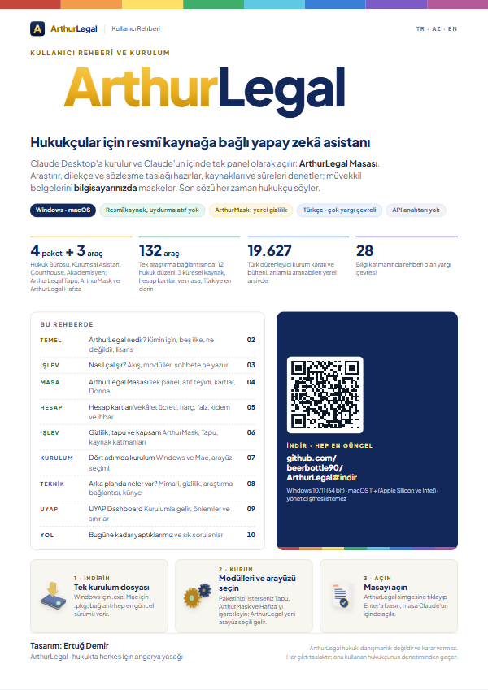
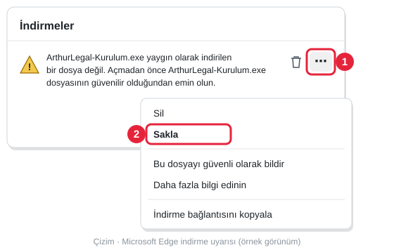
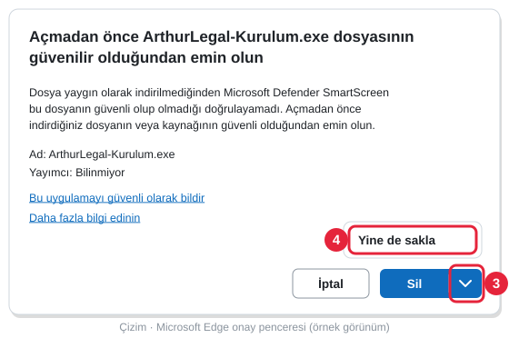
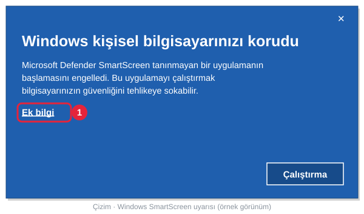
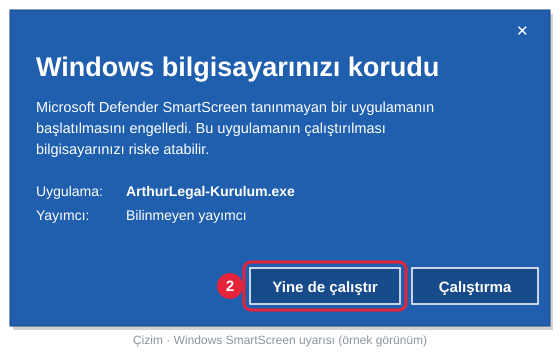
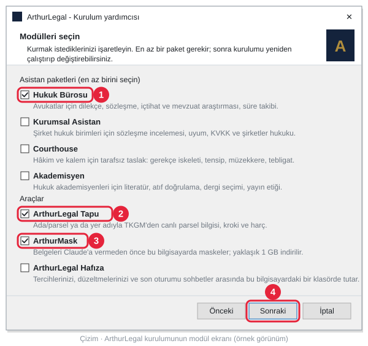
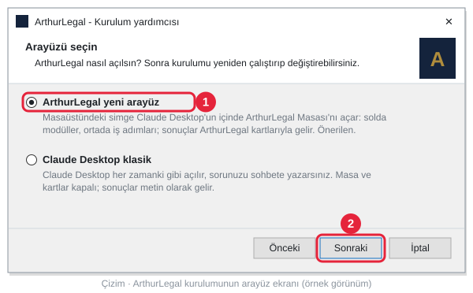
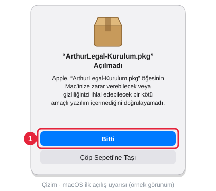
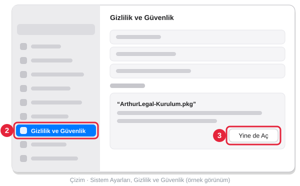
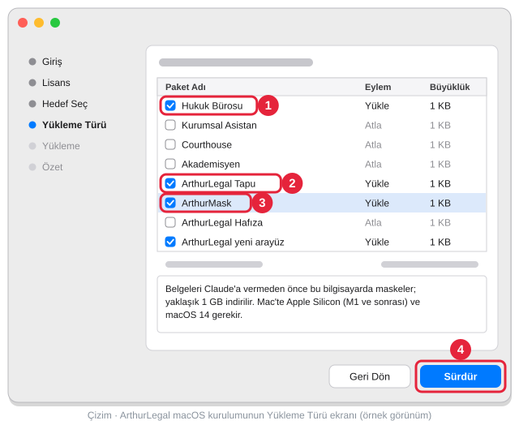

<h1 id="indir-az">ArthurLegal</h1>

**Dil:** Azərbaycan dili · [Türkçe](README.md#kurulum) · [English](README.md#download)

   
  

  <b>Windows 10 / 11</b> (64 bit) · <b>macOS 11+</b> (Apple Silicon · Intel) · administrator parolu tələb etmir 
  

<a href="#kurulum-az">Azərbaycanca quraşdırma təlimatı</a> (<a href="#mac-az">Mac</a>) · <a href="README.md#kurulum">Türkçe kurulum anlatımı</a> (<a href="README.md#mac">Mac</a>) · <a href="README.md#download">English installation guide</a> (<a href="README.md#mac-en">Mac</a>)

> [!NOTE]
> Windows quraşdırma proqramı Azərbaycan dilindədir: dil ekranında **Azərbaycan dili** seçin (Windows-unuz Azərbaycan
> dilindədirsə, o özü seçilmiş gəlir). Aşağıda quraşdırma proqramının düymə və ekran adları Azərbaycan dilində, qalın
> şriftlə yazılıb. Bu səhifədəki şəkillər türkcə quraşdırma ekranlarını göstərir; brauzerin, Windows-un və macOS-un öz
> pəncərələrindəki adlar ekranda göründüyü kimi (türkcə) yazılıb, mötərizədə Azərbaycan dilində mənası (və ingiliscə
> qarşılığı) verilir.

<h3 align="center" id="rehber-az">İstifadəçi bələdçisi</h3>

  

  <a href="docs/rehber/ArthurLegal-Kullanici-Rehberi.pdf"><b>İstifadəçi bələdçisi (PDF, 10 səhifə, türk dilində)</b></a> 
  ArthurLegal nədir, quraşdırma, ArthurLegal Masası, ArthurMask, UYAP Dashboard və tez-tez verilən suallar bir sənəddə.

<h2 id="kurulum-az">Azərbaycan dilində: yükləmə və quraşdırma</h2>

Bu addımlar Windows üçündür; Mac-də quraşdırma [aşağıdadır](#mac-az). Düymə açılmasa, bu keçidə klikləyin:
**[ArthurLegal-Kurulum.exe](https://github.com/beerbottle90/ArthurLegal/releases/latest/download/ArthurLegal-Kurulum.exe)**.
Keçid həmişə ən son versiyanı yükləyir. Quraşdırdıqdan sonra ArthurLegal yeni versiyaları arxa planda,
imzalarını yoxlayaraq özü quraşdırır; bu faylı yenidən yükləməyinizə ehtiyac yoxdur.

**1. Yükləyin.** Yuxarıdakı düyməyə klikləyin. Fayl brauzerin yuxarı sağ küncündəki yükləmələr siyahısına düşür;
siyahı bağlansa, <kbd>Ctrl</kbd> + <kbd>J</kbd> ilə açın.

**Edge** "**ArthurLegal-Kurulum.exe yaygın olarak indirilen bir dosya değil**" (ArthurLegal-Kurulum.exe tez-tez
yüklənən fayl deyil; ingiliscə "isn't commonly downloaded") yazsa, fayl silinməyib, təsdiqinizi gözləyir.
Sətirdəki zibil qutusu nişanını basmayın:

1. Siçanı sətrin üzərinə gətirin, sağda görünən **⋯** düyməsinə, sonra **Sakla** (Saxla; ingiliscə **Keep**)
   üzərinə klikləyin.
2. Açılan pəncərədə mavi **Sil** (Sil; **Delete**) düyməsinə yox, onun yanındakı kiçik oxa (**˅**) klikləyin və
   **Yine de sakla** (Yenə də saxla; **Keep anyway**) seçin. Köhnə Edge versiyalarında bu pəncərədə əvvəlcə
   **Daha fazla göster** (Daha çox göstər; **Show more**) üzərinə kliklənir.

  
  

**Chrome** "**Şüpheli indirme işlemi engellendi**" (Şübhəli yükləmə bloklandı; **Suspicious download blocked**)
yazsa: yuxarı sağdakı yükləmə nişanına, sonra faylın sətrinə klikləyin və **Şüpheli dosyayı indir** (Şübhəli
faylı yüklə; **Download suspicious file**) seçin. **Geçmişten sil** (Tarixçədən sil; **Delete from history**)
faylı silir.

**2. İki dəfə klikləyin.** Yüklənmiş **ArthurLegal-Kurulum** faylını açın; Edge-də fayl adının altındakı
**Dosya aç** (Faylı aç; **Open file**) üzərinə də klikləyə bilərsiniz. Mavi pəncərədə "**Windows kişisel
bilgisayarınızı korudu**" (Windows kompüterinizi qorudu; **Windows protected your PC**) yazılsa, narahat olmayın:
bu pəncərə kod imzası olmayan hər yeni proqramda çıxır. Siçanla əvvəlcə **Ek bilgi** (Əlavə məlumat; **More
info**) yazısına, sonra görünən **Yine de çalıştır** (Yenə də işə sal; **Run anyway**) düyməsinə klikləyin.
<kbd>Enter</kbd> düyməsini basmayın: Enter **Çalıştırma** (İşə salma; **Don't run**) seçir, quraşdırma açılmır.

  
  

**3. Modulları seçin.** Quraşdırma əvvəlcə dili soruşur: **Azərbaycan dili** seçib **OK** üzərinə klikləyin
(türkcə və ingiliscə də var: **Türkçe**, **English**). **Müqaviləni qəbul edirəm** (türkcə quraşdırmada **Anlaşmayı
kabul ediyorum**, ingiliscə **I accept the agreement**) seçib **Növbəti** (**Sonraki**, **Next**) üzərinə klikləyin.
**Modulları seçin** (**Modülleri seçin**, **Choose modules**) ekranında quraşdırmaq istədiklərinizi işarələyin; hər birinin altında nə işə yaradığı yazılır və ilk quraşdırmada
heç bir xana işarələnmiş gəlmir. Ən azı bir paket lazımdır:

| Modul | Kimin üçün |
|---|---|
| **Hüquq Bürosu** (Hukuk Bürosu) | Vəkillər və hüquq büroları |
| **Korporativ Köməkçi** (Kurumsal Asistan) | Şirkətlərin hüquq şöbələri |
| **Courthouse** | Hakim və məhkəmə dəftərxanası ([Courthouse səhifəsi](ArthurLegal-Courthouse-v1.2.5-Public-Release/), türk dilində) |
| **Akademik** (Akademisyen) | Hüquqşünas akademiklər |
| **ArthurLegal Tapu** | Ada/parsel (kadastr bloku və sahə nömrəsi) və ya yer adı ilə canlı parsel məlumatı, kroki (sxem) və rüsum |
| **ArthurMask** | Sənədləri Claude-a verməzdən əvvəl kompüterdə maskalayır (təxminən 1 GB yüklənir). Hüquq Bürosu və ya Korporativ Köməkçi ilə birlikdə seçilsə, Windows-da [UYAP Dashboard](README.md#uyap) da gəlir |
| **ArthurLegal Yaddaş** (ArthurLegal Hafıza) | Seçimlərinizi, düzəlişlərinizi və son sessiyanı söhbətlər arasında kompüterinizdəki bir qovluqda saxlayır |

  

**4. İnterfeysi seçin.** **İnterfeysi seçin** (**Arayüzü seçin**, **Choose the interface**) ekranında iki seçim var,
yalnız biri seçilir; dəyişmək üçün quraşdırmanı sonra yenidən işə sala bilərsiniz:

| İnterfeys | Nə baş verir |
|---|---|
| **ArthurLegal yeni interfeys** (**ArthurLegal yeni arayüz**, **ArthurLegal new interface**; seçilmiş gəlir) | ArthurLegal nişanı Claude Desktop-un içində [ArthurLegal Masası](README.md#masa) panelini açır: solda modullar, ortada iş addımları; maddə və məhkəmə təcrübəsi nəticələri ArthurLegal kartları ilə gəlir |
| **Claude Desktop klassik** (**Claude Desktop klasik**, **Claude Desktop classic**) | Claude Desktop həmişəki kimi açılır, sualınızı söhbətə yazırsınız; masa və kartlar bağlıdır, nəticələr mətn kimi gəlir |

  

**5. Quraşdırın.** **Növbəti**, sonra **Quraşdır** (**Kur**, **Install**) üzərinə klikləyin. Claude Desktop açıqdırsa,
quraşdırma onu bağlayır; başlamazdan əvvəl yazdığınız mesajı göndərin. ArthurMask seçmisinizsə, quraşdırma onu da
yükləyir (təxminən 1 GB, bir neçə dəqiqə); gözləmək istəməsəniz, **Yükləməni dayandır** (**İndirmeyi
durdur**, **Stop download**) düyməsini basıb çıxan iki suala **Bəli** (**Evet**, **Yes**) cavabını verin, ArthurMask sonra arxa
planda özü yüklənir. Son səhifədə **Bitir** (**Bitti**, **Finish**) üzərinə klikləyin: yeni interfeysdə Claude Desktop
masanı açmağa hazır gəlir (aşağıdakı xəbərdarlıq), klassikdə başlanğıc bələdçisi və Claude Desktop açılır.

> [!IMPORTANT]
> **Quraşdırmadan sonra Enter düyməsini basın.** Claude Desktop açılanda mesaj qutusunda *ArthurLegal Masası'nı aç*
> (ArthurLegal Masasını aç) yazılmış olur; masa siz **Enter** düyməsini basanda açılır. Mesaj öz-özünə göndərilmir.
> İş masasındakı **ArthurLegal** nişanı ilə hər açılışda da Enter düyməsini basın.

> [!TIP]
> **Model və effort.** Minimum Opus 5.5 · Medium / High effort tövsiyə edirik, məcburi deyil. Claude-un mesaj
> qutusundakı model adına klikləyib modeli və effort-u bir dəfə seçin; Claude yadda saxlayır. ArthurLegal-ın
> apardığı ölçmədə (23 çətin sual) kiçik modellər müddətlər, prosessual qaydalar və yeni dəyişmiş qanunvericiliklə
> bağlı suallarda daha çox ciddi səhv etdi; heç bir model uydurma istinad yazmadı. Limitiniz azalarsa, maddə mətni,
> istinadların yoxlanması və hesablama işlərini Sonnet 5.5 ilə görə bilərsiniz. ArthurLegal hər modellə işləyir;
> masanın **Model ve effort** ekranı ölçmə nəticələrini göstərir.

İş masasına seçdiyiniz modulların nişanları gəlir: Hüquq Bürosu və ya Korporativ Köməkçi üçün **ArthurLegal**,
həmçinin **ArthurLegal - Courthouse**, **ArthurLegal - Akademik**, **ArthurLegal - Tapu** və **ArthurMask** (türkcə
quraşdırmada Akademik nişanının adı **ArthurLegal - Akademisyen**-dir). Windows-da
Hüquq Bürosu və ya Korporativ Köməkçi ilə birlikdə ArthurMask seçmisinizsə, **ArthurLegal - UYAP Dashboard** da gəlir ([UYAP Dashboard](README.md#uyap)).
Yeni interfeysdə **ArthurLegal** nişanı Claude Desktop-u *ArthurLegal Masası'nı aç* mesajı yazılmış halda açır:
Enter düyməsini basın, masa tam ekranda açılır (solda modullar, ortada iş addımları); klassikdə Claude Desktop-u və
başlanğıc bələdçisini açır. Claude Desktop-da yeni söhbət açıb sualınızı
birbaşa da yaza bilərsiniz. Claude hər hansı aləti ilk dəfə istifadə edərkən icazə soruşsa,
**Always allow** (Həmişə icazə ver) seçin; Claude Desktop-un menyuları ingilis dilindədir. Claude Desktop
quraşdırılmayıbsa, quraşdırma onu da quraşdırmağa çalışır; açılmasa, [claude.ai/download](https://claude.ai/download) ünvanından quraşdırın.
Modul əlavə etmək, çıxarmaq və ya interfeysi dəyişmək üçün quraşdırma faylını yenidən işə salın; son seçiminiz
işarələnmiş gəlir.

<b>Bu xəbərdarlıqlar niyə çıxır, fayl təhlükəsizdirmi?</b>

Windows və brauzerlər az yüklənmiş və kod imzası olmayan hər proqramı tanımadıqları üçün xəbərdarlıq edir. ArthurLegal
quraşdırma faylı hələ ödənişli kod imzalama sertifikatı ilə imzalanmayıb; naşirin "naməlum" görünməsi
bununla bağlıdır, faylın zərərli olduğu anlamına gəlmir. Buna baxmayaraq, yalnız bu səhifədəki düymədən və ya
[buraxılış səhifəsindən](https://github.com/beerbottle90/ArthurLegal/releases/latest) yüklədiyiniz fayl üçün
davam edin; e-poçtla və ya başqa saytdan gələn nüsxəni açmayın. Quraşdırmadan sonrakı yeniləmələr
əlavə olaraq rəqəmsal imza ilə yoxlanılır: imza uyğun gəlməsə, heç nə quraşdırılmır.

İnternet bağlantısı olmayanda mavi pəncərə "**SmartScreen'e şu anda ulaşılamıyor**" (SmartScreen hazırda əlçatan
deyil; **SmartScreen can't be reached right now**) yazır; orada **Çalıştır** (İşə sal; **Run**) üzərinə
klikləyin. Təşkilatın idarə etdiyi kompüterdə **Sakla** və ya **Yine de sakla** solğun görünürsə ("Kuruluşunuz
tarafından yönetilir": təşkilatınız tərəfindən idarə olunur), quraşdırma üçün İT məsulunuza müraciət edin.

<b>"Yine de çalıştır" (Yenə də işə sal) heç çıxmır və ya "Uygulama Denetimi" (Tətbiq Nəzarəti) maneəsi var (Windows 11)</b>

Kompüterinizdə Windows 11-in **Akıllı Uygulama Denetimi** (Ağıllı Tətbiq Nəzarəti; **Smart App Control**) funksiyası
aktivdir. Bu nəzarət imzasız quraşdırma fayllarına heç icazə vermir, tək bir tətbiqə icazə vermək yolu da yoxdur.
Nəzarəti söndürməyinizə ehtiyac yoxdur; eyni quraşdırmanın zip yolundan istifadə edin:

1. **[ArthurLegal-Kurulum.zip](https://github.com/beerbottle90/ArthurLegal/releases/latest/download/ArthurLegal-Kurulum.zip)**
   faylını yükləyin (bu keçid də həmişə ən son versiyanı verir).
2. Arxivdən çıxarmazdan əvvəl zip faylına sağ klikləyib **Özellikler** (Xüsusiyyətlər; **Properties**) açın.
   **Genel** (Ümumi; **General**) vərəqinin aşağısında "Bu dosya başka bir bilgisayardan geldi…" (Bu fayl başqa
   kompüterdən gəlib…) yazılıbsa, yanındakı **Engellemeyi Kaldır** (Bloku götür; **Unblock**) xanasını işarələyib
   **Tamam** üzərinə klikləyin. Bu addım ötürülsə, Windows zipdən çıxan quraşdırma faylını da bloklayır.
3. Zip faylına sağ klikləyin, **Tümünü Ayıkla...** (Hamısını çıxar...; **Extract All...**), sonra **Ayıkla**
   (Çıxar; **Extract**) seçin. Zip-i açıb içindəki fayla birbaşa iki dəfə klikləməyin; Windows soruşsa,
   **Tümünü Ayıkla** seçin.
4. Açılan qovluqda **KUR** faylına (növü: Windows Komut Dosyası, yəni Windows əmr faylı) iki dəfə klikləyin. Qara
   pəncərə əvvəlcə modulları soruşur: quraşdırmaq istədiklərinizin nömrələrini vergüllə yazıb <kbd>Enter</kbd>
   düyməsini basın (məs. Hukuk Bürosu və Tapu üçün `1,5`). Sizdən bir düyməni basmağınızı istəyəndə quraşdırma
   bitmişdir.

Bu yolla ArthurMask quraşdırılmır (sənəd maskalama və UYAP bağlantısı işləmir); ArthurLegal paketləri, araşdırma
alətləri və Tapu işləyir.

<h3 id="mac-az">Mac-də quraşdırma</h3>

  

Düymə açılmasa, bu keçidə klikləyin: **[ArthurLegal-Kurulum.pkg](https://github.com/beerbottle90/ArthurLegal/releases/latest/download/ArthurLegal-Kurulum.pkg)**. macOS 11 və sonrası, Apple
Silicon (M1 və sonrası) və Intel Mac-lər üçün tək fayl; administrator parolu tələb etmir. Paketlər, modullar və
yeniləmələr Windows-dakı ilə eynidir; bu faylı da yenidən yükləməyinizə ehtiyac yoxdur.

**1. Yükləyin.** Yuxarıdakı düyməyə klikləyin. Fayl Yükləmələr (türkcə macOS-da İndirilenler, ingiliscə Downloads)
qovluğuna düşür.

**2. Açın.** **ArthurLegal-Kurulum.pkg** faylına iki dəfə klikləyin. Quraşdırma faylı hələ Apple-ın notarial
təsdiqini (notarization) daşımadığı üçün macOS ilk açılışda "**“ArthurLegal-Kurulum.pkg” Açılmadı**" (açılmadı;
**Not Opened**) yazır. **Bitti** (Bitdi; **Done**) üzərinə klikləyin; mavi **Çöp Sepeti’ne Taşı** (Zibil qutusuna
köçür; **Move to Trash**) üzərinə yox. <kbd>Enter</kbd> düyməsini basmayın: Enter faylı zibil qutusuna köçürür. Sonra:

1. **Sistem Ayarları** (Sistem parametrləri; **System Settings**) bölməsini açın (yuxarı soldakı Apple menyusu →
   **Sistem Ayarları**) və soldakı siyahıdan **Gizlilik ve Güvenlik** (Məxfilik və təhlükəsizlik; **Privacy &
   Security**) seçin.
2. Səhifəni aşağı sürüşdürün. ArthurLegal-Kurulum.pkg faylının bloklandığını bildirən sətrin yanındakı
   **Yine de Aç** (Yenə də aç; **Open Anyway**) üzərinə klikləyin və Mac-inizin parolunu daxil edin (və ya Touch ID).
3. Çıxan pəncərədə yenə **Yine de Aç** üzərinə klikləyin. Bu icazəni yalnız ilk açılışda bir dəfə verirsiniz.

  
  

**3. Modulları seçin.** Quraşdırma Mac-inizin dilində açılır: Mac-inizin ilk dili Azərbaycan dilidirsə,
quraşdırma səhifələri və modulların adları Azərbaycan dilində gəlir. macOS-un öz düymələri isə Azərbaycan dilində
olmadığı üçün aşağıdakı adlar türkcə ekrandakı kimidir. **Sürdür** (Davam et; **Continue**) üzərinə klikləyərək irəliləyin; lisenziya səhifəsindən
sonra çıxan pəncərədə **Kabul Ediyorum** (Qəbul edirəm; **Agree**) seçin. **Yükleme Türü** (Quraşdırma növü;
**Installation Type**) ekranında quraşdırmaq istədiyiniz modulları işarələyib **Sürdür** üzərinə klikləyin: modulun
adına klikləyəndə nə işə yaradığı aşağıda yazılır. Modullar Windows-dakılarla eynidir
(yuxarıdakı cədvəl); ilk quraşdırmada heç biri işarələnmiş gəlmir, ən azı bir paket lazımdır. ArthurMask yalnız Apple
Silicon və macOS 14 (Sonoma) və ya sonrasında seçilə bilər. Modulların altındakı **ArthurLegal yeni interfeys**
(**ArthurLegal yeni arayüz**) xanası işarələnmiş gəlir (masa və kartlar); işarəni götürsəniz, **Claude Desktop
klassik** quraşdırılır.

  

**4. Quraşdırın.** Claude Desktop açıqdırsa, quraşdırma onu bağlayır; yazdığınız mesaj varsa, əvvəlcə göndərin. Növbəti səhifədə
**Yükle** (Quraşdır; **Install**), son səhifədə **Kapat** (Bağla; **Close**) üzərinə klikləyin: başlanğıc bələdçisi
brauzerdə açılır. Seçdiyiniz modulların nişanları Uygulamalar (Proqramlar; Applications) qovluğunda (Launchpad-də) və
iş masasındadır: Hüquq Bürosu və ya Korporativ Köməkçi üçün
**ArthurLegal**, həmçinin **ArthurLegal Courthouse**, **ArthurLegal Akademik** (türkcə quraşdırmada **ArthurLegal
Akademisyen**) və **ArthurLegal Tapu**. İş masasındakı
nişanlar Windows-dakı kimi versiya nömrəsini daşıyır (məs. **ArthurLegal 3.0.12**) və yeniləmə ilə təzələnir. ArthurMask
seçmisinizsə, quraşdırmadan sonra arxa planda yüklənir (təxminən 1,2 GB); hazır olanda bildiriş gəlir və iş masasına
**ArthurMask** nişanı əlavə olunur. Quraşdırma Claude Desktop-u yenidən açır: yeni interfeysdə Claude *ArthurLegal Masası'nı
aç* mesajı ilə açılır, Enter düyməsini basın. Claude masanı tapa bilməsə, Claude Desktop-dan **Cmd+Q** ilə tamamilə çıxıb yenidən
açın, sonra **ArthurLegal** nişanına klikləyib Enter düyməsini basın. Yeni söhbət açıb
sualınızı birbaşa da yaza bilərsiniz. Claude hər hansı aləti ilk dəfə istifadə edərkən icazə soruşsa, **Always allow** seçin. Claude
Desktop quraşdırılmayıbsa, [claude.ai/download](https://claude.ai/download) ünvanından quraşdırın. Modul əlavə etmək, çıxarmaq
və ya interfeysi dəyişmək üçün quraşdırma faylını yenidən açın; son seçiminiz işarələnmiş gəlir. Silmək üçün: Uygulamalar →
ArthurLegal → **ArthurLegal-ı Sil** (türkcə quraşdırmada **ArthurLegal'i Kaldır**, ingiliscə **Uninstall ArthurLegal**).

> [!IMPORTANT]
> **ArthurLegal nişanına kliklədikdən sonra Enter düyməsini basın.** Claude Desktop mesaj qutusunda *ArthurLegal Masası'nı aç*
> yazılmış halda açılır; masa siz **Enter** düyməsini basanda açılır. Mesaj öz-özünə göndərilmir.

Bu bölməni paylaşmaq üçün keçid: **https://github.com/beerbottle90/ArthurLegal/blob/main/README.az.md** (türkcə səhifə:
**https://github.com/beerbottle90/ArthurLegal#indir**, Mac: **https://github.com/beerbottle90/ArthurLegal#mac**)
